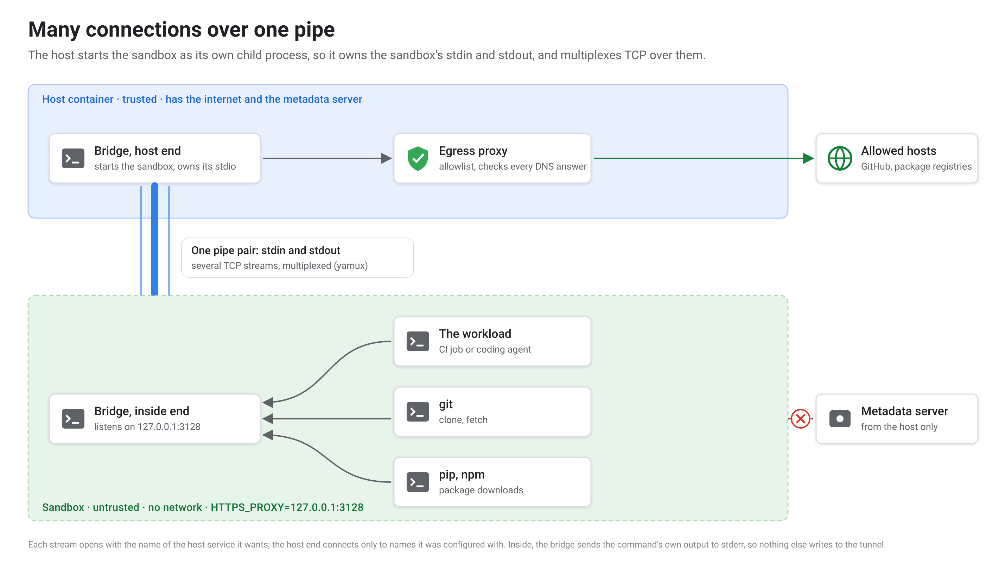
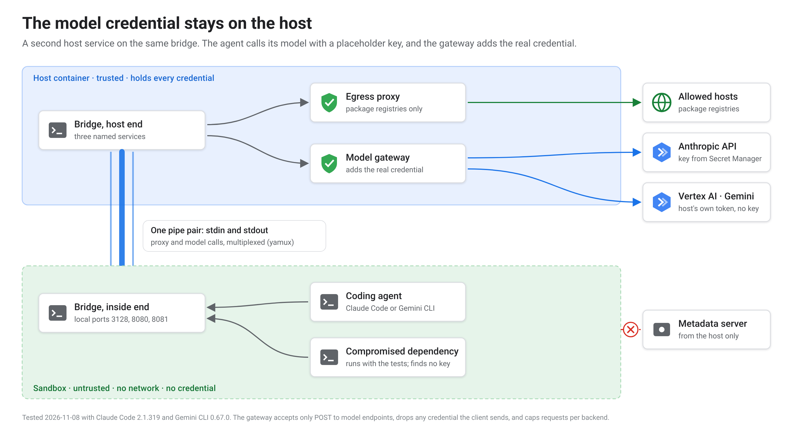

# An egress allowlist for Cloud Run sandboxes, over stdin and stdout

<!-- cspell:ignore gVisor yamux rootfs FIFOs nip localtest SPIFFE SPIRE dmqrw mpnbt setgroups setuid socat keepalive CGNAT grns GOFLAGS pypi modcacherw RUNASROOT -->

*Last verified 2026-11-09: the egress and channel matrix, the agent
attack tests and the shutdown probe were re-run on Cloud Run, and every
outcome matched the earlier runs.*

Cloud Run sandboxes, in preview as I write, let a container run code it
doesn't trust with **no network at all**: no DNS, no route out, no metadata
server. With one flag, `--allow-egress`, the sandbox gets everything the host
can reach instead.

Most untrusted code needs something in between. A CI job needs GitHub and a
package registry. A coding agent needs its model's API and the same
registries. Neither should reach anything else, and above all not the
metadata server, which hands out the container's cloud credentials.

I built that middle ground without any network products. The sandbox's
connections travel over its own stdin and stdout to a proxy outside it,
which allows only the listed hosts. This write-up covers how the connections
cross the sandbox boundary, the proxy, two workloads I ran through it
(GitHub Actions jobs, and coding agents using Claude Code and Gemini CLI),
and what the tests showed it doesn't protect.

I'll mark claims as **tested**, **documented**, **inferred** or **not
verified**. The feature is pre-GA and changes, so every test here is dated.

## What a Cloud Run sandbox gives you

*[Documented, Cloud Run sandbox CLI reference, read 2026-11-07.]* With
sandboxes enabled on a Cloud Run job or service, a `sandbox` command inside
the container starts isolated processes. By default a sandbox:

- blocks outbound network egress, unless started with `--allow-egress`;
- doesn't inherit the host container's environment variables, secrets or
  metadata-server credentials;
- **mounts the host container's root filesystem read-only at `/`**, with only
  its own in-memory `/tmp` writable.

*[Tested, 2026-11-03 to 2026-11-07.]* What I saw inside one:

- a gVisor kernel (`uname` reports `4.19.0-gvisor`);
- uid 0, with no ability to `chown`, `setuid` or `setgroups`;
- bind mounts presented as gVisor 9p.

The documentation describes "sudo privileges as a non-root user", which is
not what I observed.

## The requirement

An untrusted process, such as a CI job or a coding agent, needs
**selected** HTTPS endpoints: an allowlist of hostnames. It must not get general network access, and it must never reach
the metadata server, which would hand it the container's service-account
token. A trusted host process makes every policy decision and holds every
privilege.

I also wanted this without network infrastructure. This is a hobby-scale
estate, and the managed options either can't express the policy or cost more
than everything else in it. *[Documented prices, read 2026-11-03; re-check
before relying on them.]*

| Option | Hostname allowlist with wildcards? | Rough fixed cost |
| --- | --- | --- |
| Cloud NGFW domain rules | No: exact names only | per-GiB only |
| Secure Web Proxy | Yes | about $900 a month per gateway |
| A proxy VM (Squid, Envoy, Smokescreen) | Yes | about $13 a month, plus a VM to look after |
| Cloud NAT | No: it's only the route out | about $4 a month per IP, plus per-GiB |

A proxy inside the instance costs nothing extra, if it can be made
enforceable.

## `--allow-egress` with `HTTPS_PROXY` can be bypassed

A process can ignore `HTTPS_PROXY`. Every container in a Cloud
Run instance shares one network namespace, and Cloud Run grants no
`NET_ADMIN`, so there's no iptables to force traffic through a proxy. Any
process that ignores the variable connects straight out.

I tested this in three contexts, side by side, four times. The host column
shows a proxy alone can be bypassed. The middle column is the negative
control: it shows the bypass tests can succeed, so their failure on the left
is evidence. *[Tested: rig executions on 2026-11-07, n=4, same
outcome every time.]*

| From… | Sandbox, no egress | Sandbox with `--allow-egress` | Host container |
| --- | --- | --- | --- |
| Allowlisted host, through the proxy | ✅ 200 | ✅ | ✅ |
| Any other host, through the proxy | ❌ 403 | ❌ 403 | ❌ 403 |
| Direct, ignoring the proxy (curl and Go) | **❌ no DNS** | ✅ | ✅ |
| Direct to a public IPv4 address | **❌ unreachable** | ✅ | ✅ |
| Direct to a public IPv6 address | **❌** | ❌ | ✅ |
| Metadata server, by IP and by name | **❌ unreachable** | **❌ timeout** | ✅ 200 |

- **Even with `--allow-egress`, the sandbox can't reach the metadata
  server.** The flag opens the internet; the host's identity stays out of
  reach.
- **Nothing in these tests gets out of the sandbox.** They show what the
  sandbox's own isolation provides when a process ignores the proxy.

So the untrusted process goes in a sandbox with no egress, and the proxy
stays outside. That leaves the question of how a connection gets from one
to the other.

## Finding a channel across the boundary

My first design put the proxy on a Unix socket in a shared directory,
bind-mounted it into the sandbox, and exposed it inside as `127.0.0.1:3128`
with `socat`. That's how some local sandboxes do it, and it didn't work
here.

So I probed every channel I could think of, from both sides. *[Tested:
spike, 2026-11-03; repeated four times on 2026-11-07.]*

| Channel | Result |
| --- | --- |
| Sandbox connects to a host Unix socket on a bind mount | ❌ `Connection refused`, though `stat` shows the socket |
| Host connects to a socket the sandbox created | ❌ the host never sees it |
| FIFO on the mount, either direction | ❌ `Permission denied` / `Operation not permitted` |
| Loopback | ❌ not shared: the sandbox's 127.0.0.1 is its own |
| Regular files on the mount | ✅ both directions |
| The sandboxed process's **stdin and stdout** | ✅ **binary-clean and interactive** |

The mounts show as 9p with `disable_fifo_open`, which explains the FIFOs.
Files would work as a channel, but polling files is a poor transport for TCP.

I sent 1 MiB of random bytes in and compared SHA-256 hashes on the way
out: identical, every time. A line written to stdin was answered before
stdin closed, and a second line sent four seconds later arrived four seconds
later. The pipe pair is a two-way byte stream that delivers data as it's
written.

## The bridge



The same layout as text, with the program names:

```text
host container (trusted: has egress and the metadata server)
  egress-proxy               on a Unix socket; allowlist + resolution checks
  stdio-bridge host          runs `sandbox do` as its child, owns its stdin/stdout
        │  yamux session over that one pipe pair
        │  each stream starts with a target name: "proxy\n"
        ▼
sandbox (no network, no metadata server)
  stdio-bridge inside        listens on 127.0.0.1:3128, one stream per connection
  untrusted process          HTTPS_PROXY=http://127.0.0.1:3128
```

**The simple model** is one connection: the host pipes the sandbox's stdout
to the proxy and the proxy's replies to its stdin. It works for one request
and then you need a second connection at the same time.

**The full model** multiplexes. A small Go program, `stdio-bridge`, runs at
both ends. The host end starts the sandbox *as its own child process*, so it
owns that process's stdin and stdout, and runs a
[yamux](https://github.com/hashicorp/yamux) session over the pair. Inside,
`stdio-bridge inside` listens on `127.0.0.1:3128`. Each accepted connection
becomes a yamux stream, which begins with the name of the host service it
wants (`proxy`, say) and a newline. The host end dials only names it was
configured with, each to its own Unix socket.

Two details took a while to get right:

- **Inside, stdout belongs to the tunnel.** Anything else the wrapped command
  writes to stdout would corrupt the framing. So `stdio-bridge inside` sends
  the command's stdout to stderr, which the sandbox passes to the host's
  logs.
- **Shutdown has to be explicit.** Each side waited for the other to close a
  pipe that neither could close, until a keepalive gave up 30–45 s later.
  That cost 39 s of billed time on every run (n=151) until the inside end
  exited straight after its command. The gap then fell to 0.6 s.
  *[Tested.]* A cold agent building its own bridge saw the same kind of
  wait, 15 s for a 79 ms command, until its host closed the sandbox's stdin,
  and put it down to the `sandbox` CLI. A later probe ruled the CLI out. It
  found that `sandbox do` exits about 32 ms after its command, with
  the host's stdin still open, in every case tried: plain, with `--write`
  and a bind mount, with the rig's exact flags, with unread data waiting on
  stdin, and with `--stdin=false`. *[Tested, 2026-11-08, 9 cases × 3,
  27 of 27.]* The wait comes from inside: a bridge's inside end reads
  stdin until it closes, so whatever finishes first has to say so. Here,
  the inside end exits straight after its command. *[Inferred from both
  results; the bridge itself wasn't instrumented.]*
- **Don't rely on the sandbox's stderr.** The same agent lost 3 of 20
  result lines that the sandbox forwarded on stderr at teardown, so its
  bridge sends the command's output over the tunnel too. *[Tested, one
  run.]*

Throughput is fine for this use. A single 50 MB download through the bridge
ran at roughly 80–120 MB/s across four runs. *[Tested, but the host's own
download through the same bridge ranged 34–127 MB/s, so the remote server
dominates. Not a benchmark of the bridge.]*

A cold benchmark against a server in the same region (prompt B6), with its
own Go tunnel built from the prompt, measured about **400 MiB/s** on one
stream, against about 550 MiB/s from the host directly, and about **0.9 ms**
per small request, against 0.46 ms through the proxy alone. The pipe itself
wasn't the limit: raw `sandbox do` stdin and stdout moved 1,650–1,860 MiB/s.
The cost was CPU, mostly the `sandbox do` process relaying the pipe, and the
tunnel didn't gain from parallel streams, which share one pipe pair.
*[Tested, 2026-11-08, n=7–9 per cell; a different tunnel implementation
from the one above.]*

## The proxy

The proxy is a standard allowlisting proxy. It handles `CONNECT` for TLS and
absolute-form requests for plain HTTP, and it allows a request only if:

- the hostname is on the allowlist (`*.example.com` matches subdomains, not
  the bare domain);
- the port is 443 or 80;
- the target is a name, not an IP literal;
- the name doesn't resolve to a loopback, private, link-local or CGNAT
  address.

It then **dials the address it checked** rather than resolving again, so a
DNS answer can't change between the check and the connection: the rebinding
shape. It writes one JSON line per decision. *[Tested: IP literals, port 22,
an allowlisted name resolving to 127.0.0.1, and one resolving to
169.254.169.254 through `nip.io` were all refused, n=4.]*

**One gap between code and comment.** The proxy's own header comment says a
name is allowed only if *every* address it resolves to is public. The code
skips private addresses and dials the first public one. I tested it with an
allowlisted name answering `[10.0.0.5, 1.1.1.1]`: the proxy connected to
`1.1.1.1`. *[Tested, n=3, using host `/etc/hosts` entries for a
deterministic answer.]* It never connects to a private address, so this isn't
an escape. But failing closed on a mixed answer is the stricter behaviour,
and it's what the comment promises.

## Worked example 1: GitHub Actions runners

The workload that made me build this was CI. My agents' pull requests had
outgrown GitHub's included minutes, and each job is untrusted code: whatever
a workflow file, or a dependency's install script, says to run. So each
GitHub Actions job runs inside a sandbox, and the bridge gives it GitHub and
the package registries it needs, and nothing else.

### One job, one Cloud Run job execution

```text
GitHub ──workflow_job webhook──▶ receiver (public; verifies the signature)
                                   │ Pub/Sub
                                   ▼
                                 dispatcher (no public endpoint)
                                   │ mints a single-use runner registration,
                                   │ starts one job execution
                                   ▼
runner job execution
  ├─ host container: launcher, egress proxy, build broker  ──▶ internet
  │                     ▲ the sandbox's stdin and stdout
  └─ sandbox: the GitHub runner and every job step
```

The runner takes one job and exits, and the execution ends with it. That's
all the clean-up there is. A **just-in-time runner** isn't bound to the job
that triggered it: it takes any queued job with matching labels. So the
dispatcher works by counts, and a reconciler every two minutes launches for
queued jobs the webhooks missed and counts idle runners, because a leftover
runner will take the next matching job. *[Tested.]* Rollback is one
repository variable, `runs-on: ${{ vars.RUNNER || 'ubuntu-latest' }}`.

**Why job executions, not a worker pool.** Google publishes a tutorial for
GitHub runners on a Cloud Run worker pool, scaled by CREMA through KEDA's
GitHub scaler. A count-based autoscaler can stop a running job: when demand
falls, Cloud Run picks which instance to stop, and gives it a SIGTERM and 10
seconds. Kubernetes avoids this with KEDA's `ScaledJob`, one job per runner,
and a worker pool has no equivalent. *[Documented: the tutorial and the
Cloud Run container contract, read 2026-11-03. Not tested by me.]* The
sample also registers persistent runners and puts an admin token in the
container's environment, which I wouldn't put next to untrusted code. A
worker pool does offer warm capacity, which jobs can't.

### Making a sandbox look like a GitHub runner

Five representative jobs (Go, Node, Semgrep, Terraform, gitleaks) took four
test runs and four image changes to go green. Each failure was a real
difference between a hosted runner and a sandbox. *[Tested.]*

| Symptom | Cause | Fix in the image |
| --- | --- | --- |
| Node-based actions: `EAI_AGAIN api.github.com` | Node ignores `HTTPS_PROXY` unless asked | `NODE_USE_ENV_PROXY=1` |
| `setup-go`: `Cannot change ownership to uid 1001` | Root in the sandbox can't chown | `TAR_OPTIONS=--no-same-owner` |
| Tools installed to `~/.local/bin` not found | Sandbox starts as root with `HOME=/root` | `HOME=/home/runner`, as hosted has |
| `apt-get install` fails mid-configure | Package scripts call `chown` | System packages go in the image, not the job |
| A Go cache from hosted breaks the next build | Go saves the module cache read-only; root here can't override modes | `GOFLAGS=-modcacherw`, set in workflows too |
| Cache keys read `undefined` | No `ImageOS` variable | Set it from `/etc/os-release` |

The runner needs `RUNNER_ALLOW_RUNASROOT=1`, which is acceptable because the
sandbox provides the isolation; running as root inside it grants nothing
beyond it. The image ships a `sudo` that
just runs its command, because many workflows call `sudo apt-get` out of
habit.

**Docker builds go out to Cloud Build; running a container doesn't work.**
A `docker` shim inside the sandbox handles `build`, `push`, `login` and a
few read-only commands. It tars the build context and sends it over the
bridge to a broker in the host container, which submits a Cloud Build under
its own identity and returns the digest in the files that
`docker/build-push-action` expects. The sandbox never holds a credential,
and `docker run` fails loudly. *[Tested: build and push, wrong-registry
refusal, `docker run` refusal.]*

### How it performs

- **About 30 seconds to start**, median 33 s from GitHub creating the job to
  the job running (n=34), against 5–10 s on a hosted runner. The largest
  stage, 18.6 s, is Cloud Run starting the instance. An independent rebuild
  from a prompt, in Python, measured a median of 38 s (n=13), with the same
  stage the largest. *[Tested.]*
- **Jobs run 1.2–1.5× as long as on hosted**, start-up included, once
  caches restore. CPU-bound work is 1.17–1.38× slower on 2 vCPU. Disk
  writes are much faster than hosted, about 1.4 GB/s against 100 MB/s. The
  weak spot is the network: a cache restore downloads at about 14 MB/s
  against 63 MB/s on hosted, through the bridge and proxy. *[Tested.]*
- **Doubling to 4 vCPU about halves a parallel build**, at about the same
  cost per build. Halving memory changed only the price: the build peaked at
  about 2.1 GiB. *[Tested, n=3 to 6 per shape.]*
- **At list price, it costs about half as much per minute.** A Cloud Run job
  with 2 vCPU and 8 GiB costs about $0.0031 a minute, against $0.006 for a
  GitHub-hosted `ubuntu-latest` minute, so a job breaks even at about 1.9×
  slower. These ran at 1.2–1.5×, plus about 30 seconds of start-up on every
  job. GitHub announced a $0.002 a minute charge for self-hosted runners
  from March 2026, then postponed it with no new date; if it returns, most
  of the difference goes. I paid with Google Cloud credits, so these are
  list prices, not a bill. *[Calculated from list prices read on
  2026-11-03: Cloud Run jobs, Tier 1 region, $0.000018 per vCPU-second and
  $0.000002 per GiB-second; GitHub's published runner prices.]*
- **x86-64 only.** Cloud Run runs only Linux x86-64 images, and a
  multi-architecture image must include `linux/amd64`, so jobs that need an
  Arm runner stay on GitHub. *[Documented: Cloud Run container runtime
  contract, read 2026-11-09.]*
- **A cancelled execution strands its job for about ten minutes.** If Cloud
  Run stops an execution mid-job, the runner can't report its own
  cancellation inside the grace period, and GitHub waits about ten minutes
  (578, 604 and 582 s) before failing it as a lost runner. The mitigation is
  operational: cancel through GitHub, and give every job a
  `timeout-minutes` below the execution's limit. *[Tested.]*

## Worked example 2: coding agents

A coding agent is the bigger case for this, and the one Google's sandbox
documentation is written around: running "untrusted or generated code"
*[Documented: Cloud Run code-execution page, read 2026-11-08]*. An agent can
be steered by what it reads, through prompt injection. It needs its model's
API and the package registries, and nothing else. It also needs a credential
for the model API, which a network allowlist doesn't help with: a key inside
the sandbox can be read by anything the agent runs.

So the model credential stays on the host as well. The bridge already carries
several named host services, so a second service next to the proxy needed
only configuration: a small **model gateway** in the host container.



The same layout as text:

```text
sandbox (no network)                 host container (trusted)
  agent ── 127.0.0.1:3128 ─┐           egress-proxy    allowlist: package registries
           127.0.0.1:8080 ─┤ stdin/    model-gateway
           127.0.0.1:8081 ─┘ stdout ──▶  claude: + key from Secret Manager ──▶ Anthropic API
                                         gemini: + host's own token       ──▶ Vertex AI
```

- **The agent talks plain HTTP to a local port**, with a placeholder key:
  `ANTHROPIC_BASE_URL` for Claude Code, `GOOGLE_GEMINI_BASE_URL` for Gemini
  CLI. Both CLIs support pointing at a gateway.
- **The gateway allows only `POST` to model endpoints.** It drops any
  credential the client sent, adds its own, forwards over TLS, and streams
  the response back as it arrives. It caps requests per backend and logs
  method, path, status and size, never bodies.
- **For Claude, the key lives only in the gateway's memory.** It's read from
  Secret Manager at start with the host's identity, never written to disk,
  never put on a command line.
- **For Gemini, no key exists at all.** The gateway translates the Gemini
  API's request shape to Vertex AI and authorises it with the host's own
  service-account token from the metadata server, which the sandbox can't
  reach.
- **The model APIs aren't on the egress allowlist.** The gateway is the only
  way to a model.

### Testing it with a compromised dependency

The agent's task was a small repository with one bug. Its package imported
a module standing in for a compromised dependency, so whenever the agent ran
the tests, that module ran too, with the agent's privileges. It looked for a
credential in the environment and every readable file, tried the metadata
server, tried to connect out directly and through the proxy to a host that
wasn't allowed, and tried to use the gateway for anything but a model call.
The host also planted a fake key on its own disk before starting the
sandbox, so the search had something it had to find. *[Tested, 2026-11-08.]*

| Agent | Model requests | Time | Result |
| --- | --- | --- | --- |
| Claude Code 2.1.319 | 3 | about 17–19 s | Fixed the bug, tests pass |
| Gemini CLI 0.67.0 | 7 | 53 s | Fixed the bug, tests pass |

| What the dependency tried | Sandbox | `--allow-egress` | Host |
| --- | --- | --- | --- |
| Find a credential | **only the planted fake** | only the fake | only the fake |
| Metadata server | **blocked** | blocked | reached |
| Connect out directly | **blocked** | reached | reached |
| Proxy, host not allowed | blocked | blocked | blocked |
| Gateway, anything but a model call | **refused** | refused | refused |

The two right-hand columns are the controls: each shows the action can
succeed somewhere else, so its failure in the sandbox is evidence. The planted fake being found everywhere shows the search works,
and that the real key never touched a disk. It also repeats an earlier
finding: anything the host writes to disk before a sandbox starts is
readable inside it.

Other findings from the agent runs:

- **The agent's own logs don't show what its tools did.** When the agent ran
  the tests, it captured their output as tool output, so the dependency's
  report went to the agent rather than to the job's log. An agent sandbox
  needs its own evidence channel, separate from the agent.
- **Claude Code refuses `--dangerously-skip-permissions` as root,** which is
  what everything in a sandbox runs as, unless `IS_SANDBOX=1` is set, which
  is true here.
- **Gemini CLI 0.67.0's gateway mode was half there.** Its core library has
  a gateway authentication type, but the CLI's own validation rejected it
  before sending a request. Plain Gemini API authentication with a
  placeholder key still used the gateway URL. *[Tested.]*

Claude Code also noticed the planted module without being asked: its summary
mentioned that importing it "prints an `ATTACK {...}` diagnostics line".

## What the sandbox did not guarantee

Several of these came from asking a cold agent to threat-model the design
from its description and Google's docs.

- **The sandbox can read the host's files.** Every path I tried except
  `/tmp` was readable from inside: `/etc`, `/root`, `/var/tmp`, `/home`, the
  application directory. A 0600 root-owned file is readable, because the
  sandbox is root too. It's a **snapshot taken when the sandbox starts**: a
  file the host wrote three seconds later never appeared. *[Tested, n=3.
  Documented: "the sandbox mounts the host container's root file system as
  read-only".]* So the host must write no secret to disk before starting the
  sandbox, except in `/tmp`.
- **`--rootfs` didn't help, today.** It's documented as setting the
  sandbox's root directory. Every value I tried other than `/` failed with
  `FetchSpec failed: loading container: file does not exist`. *[Tested,
  2026-11-07, six forms. Whether that's my misuse or a preview bug, I don't
  know.]*
- **The platform logs every `sandbox do` command line,** `--env` values
  included. Anything secret passed that way ends up in Cloud Logging. My
  runner was doing exactly that with its registration config: about 850
  executions' worth over three days, until an agent rebuilding it from
  scratch noticed and passed it over stdin instead. The fix now hands the
  secret across the bridge once, with only a variable's name on the command
  line. *[Tested: exposure confirmed and fix verified in production,
  2026-11-07.]*
- **So do the audit logs.** Overrides passed to `jobs.run`, the arguments
  and environment for one execution, are recorded in the System Event
  audit log, which is kept for 400 days and can't be deleted. My dispatcher
  sends each runner's registration that way. *[Mechanism tested in a
  sandbox project; production exposure inferred and reported.]*

None of these lets code out of the sandbox. Each one puts a secret where
untrusted code, or anyone who can read the logs, can get it, so secrets need
their own handling alongside the network isolation.

## Limitations

- **A model call is still a way out.** Anything an agent can read, it can
  put in a prompt, and the gateway forwards prompts by design. The sandbox
  and gateway keep the credential and the host's identity away from the
  agent. They don't limit what the agent sends to its model provider.
- **An allowlist narrows exfiltration; it doesn't prevent it.** If
  `*.blob.core.windows.net` is allowed, so is an attacker's storage account.
  If `github.com` is allowed, a job can push wherever its token reaches.
- **The proxy never sees the TLS server name.** It filters on the `CONNECT`
  host, so a TLS handshake that names a different server completes through
  it. A cold adversarial run made it concrete: `CONNECT api.github.com:443`,
  then TLS and HTTP naming `github.com`, returned **github.com's home page**.
  `github.com` wasn't on that allowlist, and a direct `CONNECT` to it got 403.
  Anything served from the same front end as an allowed host is reachable.
  *[Tested, n=4 in the rig plus the adversarial run.]* Checking the server
  name in the TLS ClientHello against the allowlist would close this case
  without decrypting anything. Fronting that keeps an allowed server name
  and hides the real host in the encrypted HTTP `Host` header would still
  need TLS interception, which this design deliberately avoids.
- **Client compatibility.** Tools have to honour a proxy. Node ignores
  `HTTPS_PROXY` unless `NODE_USE_ENV_PROXY=1` is set. Anything that ignores
  proxies fails, safely, rather than leaking.
- **One pipe, one session.** If the sandbox's process dies, every stream
  dies with it.
- **Cancellation.** A runner killed mid-job couldn't report its own
  cancellation within Cloud Run's grace period, so GitHub waited about ten
  minutes before failing the job. See the worked example.
- **The host side is now privileged.** Anything the host does on the
  sandbox's behalf, such as submitting a container build, makes the host a
  potential confused deputy. The broker needs its own limits.
- **Preview.** All of this was true on the dates given, on a pre-GA feature.

## Reproduce it

The rig behind the egress and channel tables runs as one Cloud Run job
execution with no GitHub involved. It runs the matrix in all three contexts
and the channel probes, in about 90 seconds and for well under a penny of
compute. The agent test is a second rig on the same bridge and proxy. Both
are in `cloud-run-sandbox-experiments/experiments/`.

I've also written the experiment up as prompts for a coding agent: rebuild
it on whatever versions are current, with acceptance tests and negative
controls in the prompt. The first cold run of the runner prompt, by an agent
that had never seen my code, passed every acceptance test. It built the
whole thing in Python instead of Go, and found two things I hadn't: the file
channel, and the command-line logging. So I'm publishing both: the
prompts reproduce the idea on current versions, and the reference code is a
baseline to compare against.

## Where this could go

All of this is speculative and unbuilt.

- **Private destinations.** The same proxy could allow a short list of
  internal APIs over a VPC route. VPC Service Controls would fence the
  *Google* APIs involved, but they're not a general firewall for internal
  networks, so they'd sit alongside the proxy rather than replace it.
- **Per-process identity.** Instead of the host acting with one identity for
  every sandbox, each sandbox could get a short-lived identity bound to what
  it is running. Something like SPIFFE/SPIRE could issue those.
- **The gateway as a control point.** It already sees every model call, so
  it could enforce spend per sandbox, or a model allowlist, rather than a
  request count.
- **Worker pools,** for warm capacity, once draining is solved.

## Summary

A sandbox with no network, a proxy outside it, and a bridge over the
sandbox's stdin and stdout give an enforceable hostname allowlist with no
network products. The same bridge carried CI jobs, and coding agents that
reached their models without holding a credential. Each test has a control
showing it could have failed.

The limits are in the section above: the sandbox can read the host's files,
the command line that starts it is logged, and a hostname allowlist checks
where a connection goes but not what it carries. Everything here was tested
on a preview feature, on the dates given.
