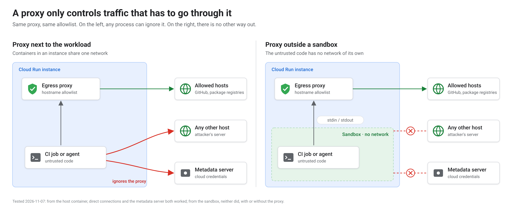
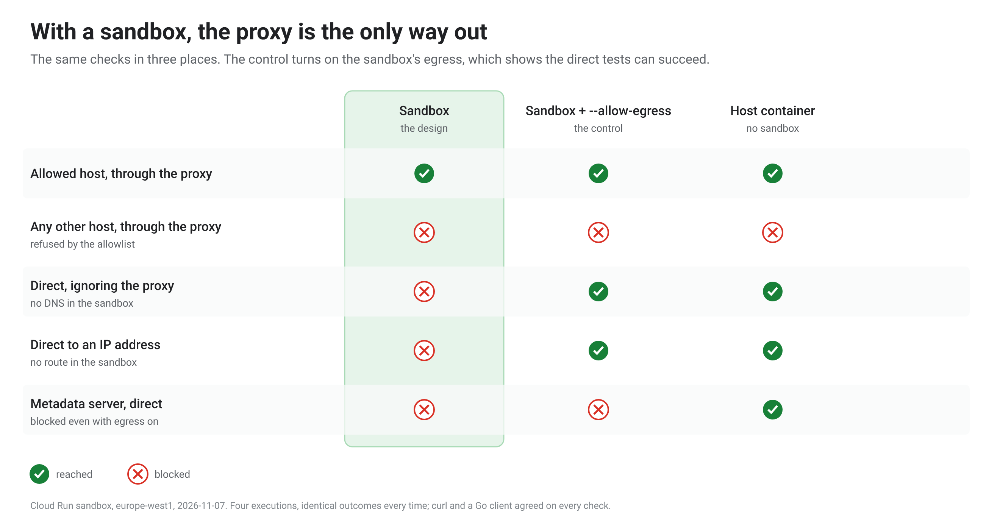
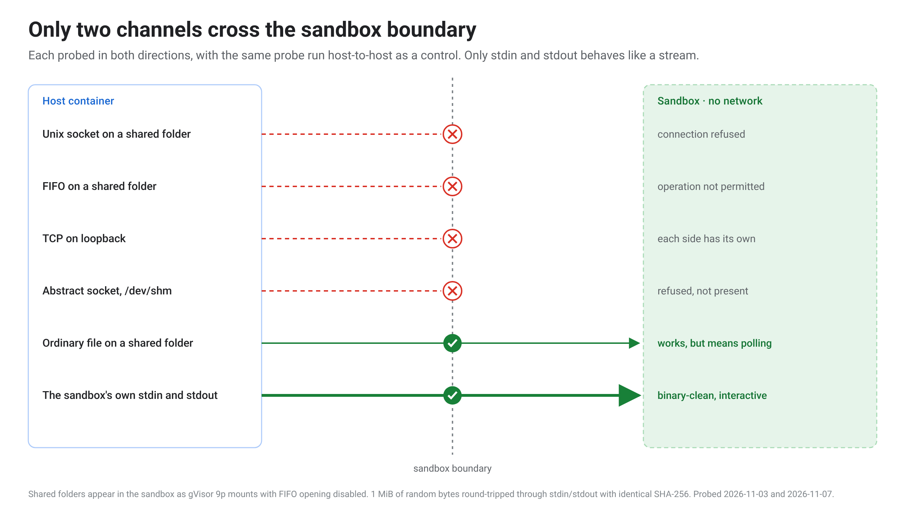
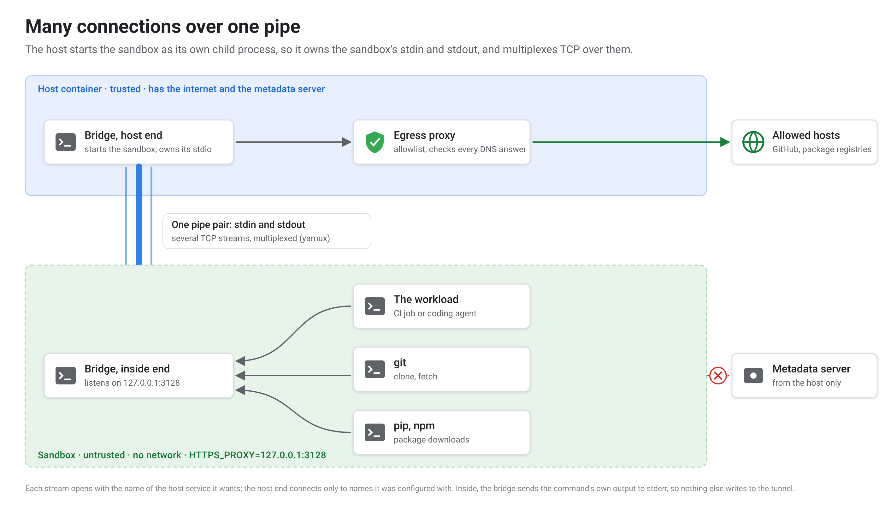
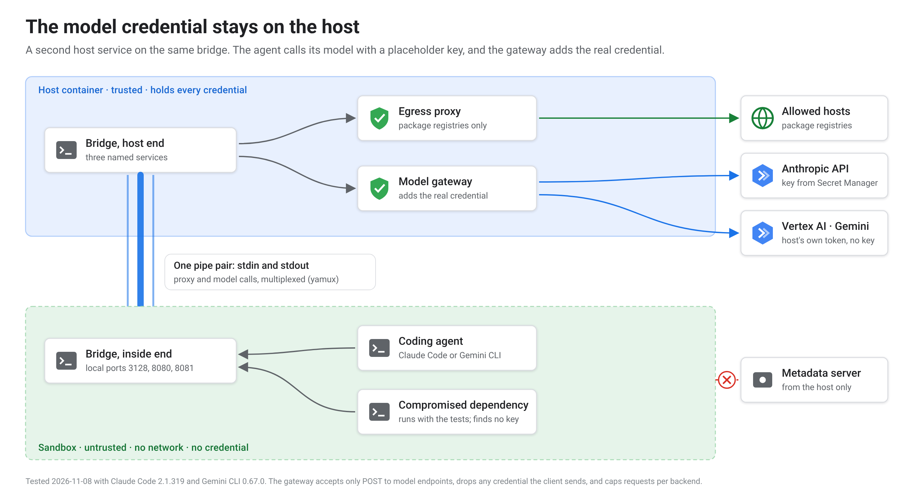

# Networking Cloud Run sandboxes over stdin and stdout

<!-- cspell:ignore yamux gVisor -->

> The short version of [the full write-up](article.md), which holds the
> evidence, sources and caveats behind every claim here.

---

Cloud Run sandboxes, in preview, let a container run code it doesn't trust
with no network at all, or, with one flag, with the whole internet. Most
untrusted code needs something in between. A CI job needs GitHub and a
package registry. A coding agent needs its model's API and the same
registries.

I built that middle ground without extra network products. The
sandbox's connections travel over its own stdin and stdout to a proxy
outside it, which allows only the listed hosts. Below: how that works, the
two workloads I ran through it (GitHub Actions jobs and coding agents), and
what it doesn't protect.

## What a Cloud Run sandbox gives you

A container with sandboxes enabled can start isolated processes with a
`sandbox` command. By default a sandbox has **no outbound network**,
doesn't inherit the container's environment or its metadata-server
credentials, and sees the container's filesystem read-only, with its own
in-memory `/tmp`. Inside, processes run as root on a gVisor kernel.

## Turning egress on

`--allow-egress` gives the sandbox the whole internet. Pointing
`HTTPS_PROXY` at an allowlisting proxy doesn't help, because the variable is
only a setting: any process that ignores it connects straight out. Cloud Run gives a
container no way to force traffic through a proxy. So the sandbox keeps its
default of no network, and the proxy runs outside it.

To check that holds, I ran the same tests in the sandbox, in the sandbox with
`--allow-egress` as a control, and in the host container. In the sandbox,
everything except an allowed host through the proxy fails, and the controls
show each of those tests can succeed. **The metadata server stays
unreachable from the sandbox even with egress on.**

## Finding a way across the boundary

My first design, a Unix socket in a shared folder, didn't work. So I
probed every channel I could think of, in both directions.

Sockets, FIFOs and loopback all fail: shared folders are 9p mounts under
gVisor, and each side has its own loopback. Ordinary files cross, but would
need polling. The channel that works is the sandboxed process's **own stdin
and stdout**. A mebibyte of random bytes came back with an identical hash,
and a line sent mid-stream was answered straight away.

## The bridge

A small Go program runs at both ends. The host end starts the sandbox as its
own child process, so it owns that process's stdin and stdout, and runs a
multiplexed session over them (HashiCorp's yamux). The inside end listens on
local ports, and every connection becomes a stream that names the host
service it wants. The host connects only to names it was configured with.

The proxy is a standard allowlisting proxy. It allows a hostname on the list, on port
443 or 80, and then connects to the address it checked, so an allowed name
can't be pointed at the metadata server.

## Workload 1: GitHub Actions jobs

Each CI job is untrusted code: whatever a workflow or a dependency's install
script says to run. Each job runs in its own Cloud Run job execution, inside
a sandbox, reaching GitHub and the registries and nothing else. A runner in a
sandbox needed some image changes, because it runs as root and can't
`chown`. Jobs start in **about 30 seconds** and run **1.2–1.5× as long** as
on GitHub's runners. At list price, a 2 vCPU Cloud Run minute costs about
half a GitHub-hosted one, so they still came out cheaper, though GitHub has
postponed, not cancelled, a charge for self-hosted runners that would erase
most of the difference. Cloud Run only runs x86-64 images, so Arm jobs stay
on GitHub.

## Workload 2: coding agents

An agent also needs a credential for its model. A key inside the sandbox
could be read by anything the agent runs, including code a prompt injection
talked it into running, so the credential stays on the host.
The bridge already carries several named services, so I added a small
**model gateway** next to the proxy.

The agent talks plain HTTP to a local port with a placeholder key. The
gateway accepts only model calls, swaps in the real credential and forwards
them. For Claude, the key lives only in the gateway's memory. For Gemini,
there's no key at all: the gateway calls Vertex AI with the host's own
identity.

I tested it with a planted compromised dependency that ran whenever the agent
ran the tests. **Claude Code fixed the task in 3 model requests, and Gemini
CLI in 7.** Meanwhile the dependency found no credential, couldn't reach the
metadata server or connect out, and was refused every gateway call that
wasn't a model call. The controls showed that the metadata server and
direct connections do work from outside the sandbox.

## How well it holds up

I also gave coding agents written prompts with acceptance tests and none of
my code. One rebuilt the tunnel from scratch and passed every test. Another
was asked to break it: direct egress, the metadata server, URL tricks, DNS
rebinding and malformed tunnel traffic were all blocked, each with a control
showing the attack could have worked.

## What it doesn't protect

- **The sandbox can read the host's files.** Anything the host writes to
  disk before starting the sandbox is readable inside. Keep secrets in
  memory.
- **Command lines are logged.** Pass secrets over the bridge, never as
  arguments or environment.
- **An allowlist checks only where a connection goes.** Through
  an allowed GitHub host, an agent fetched github.com, which wasn't on the
  list. Checking the server name in the TLS handshake would close the simple
  case.
- **A model call is a way out.** Anything an agent can read, it can put in a
  prompt. The gateway keeps the credential from the agent, and forwards what
  the agent sends.

None of these lets code out of the sandbox, but each needs handling of its
own.

## Takeaways

1. **Start from no network, then add one controlled way out.** Filtering a
   network that's already open is harder to get right.
2. **Probe the boundary before designing around it.** A shared socket, the
   usual approach, didn't work here; stdin and stdout did.
3. **Keep credentials on the host.** A gateway that adds them is simpler
   than protecting a key inside the sandbox.
4. **Treat files, command lines and logs as their own risks.** Network
   isolation doesn't cover them.

---

*This is an experiment on a preview feature, tested in November 2026, not a
product or a finished security boundary. If Cloud Run adds an egress
allowlist, the bridge becomes a workaround for a missing feature. The rigs,
the gateway and prompts to rebuild them are at
[github.com/pmgledhill102/cloud-run-sandbox-experiments](https://github.com/pmgledhill102/cloud-run-sandbox-experiments).
The full write-up, with every source and caveat, is
[`article.md`](https://github.com/pmgledhill102/cloud-run-sandbox-experiments/blob/main/article.md)
there.*
